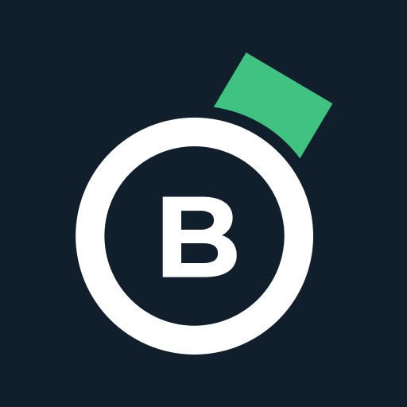

# @blockonomics/medusa-payment-blockonomics

Accept Bitcoin in [Medusa](https://medusajs.com) v2 through [Blockonomics](https://www.blockonomics.co). Payments go straight to your own wallet: each checkout gets a fresh address, and Blockonomics notifies Medusa as the transaction confirms.

Blockonomics never holds funds, so refunds are manual. See [Refunds](#refunds).

## Requirements

- Medusa `2.19.0` or later
- A Blockonomics account with a store and a wallet (xPub) attached
- A Medusa server reachable from the internet, for callbacks

## Install

```bash
npm install @blockonomics/medusa-payment-blockonomics
```

## Configure

### 1. Register the plugin and the provider

```ts
// medusa-config.ts
module.exports = defineConfig({
  plugins: [
    { resolve: "@blockonomics/medusa-payment-blockonomics", options: {} },
  ],
  modules: [
    {
      resolve: "@medusajs/medusa/payment",
      options: {
        providers: [
          {
            resolve: "@blockonomics/medusa-payment-blockonomics/providers/blockonomics",
            id: "blockonomics",
            options: {
              apiKey: process.env.BLOCKONOMICS_API_KEY,
              callbackSecret: process.env.BLOCKONOMICS_CALLBACK_SECRET,
              confirmations: 2,
            },
          },
        ],
      },
    },
  ],
})
```

Both entries are required. Without the `plugins` entry, callbacks return `404` and no payment completes.

Generate the callback secret in your project and add the printed line to `.env` with your API key:

```bash
npx blockonomics-callback-secret
# BLOCKONOMICS_CALLBACK_SECRET=MEDUSA_...
```

The secret must start with `MEDUSA_`. It is yours, not issued by Blockonomics.

### 2. Set the callback URL in Blockonomics

In the Blockonomics dashboard, under **Stores**, set the store's callback URL to:

```
https://your-store.com/hooks/blockonomics/blockonomics_blockonomics?secret=YOUR_CALLBACK_SECRET
```

The path is `/hooks/blockonomics/blockonomics_{id}`, where `{id}` is the provider `id`. Callbacks with a wrong secret are ignored, so a typo leaves orders unpaid without any error.

### 3. Enable the provider in a region

In the Medusa admin, under **Settings → Regions**, add **Blockonomics** (`pp_blockonomics_blockonomics`) to the region.

## Options

**Required**

- `apiKey`: your Blockonomics API key.
- `callbackSecret`: the secret in the callback URL. Starts with `MEDUSA_`.

**Optional**

- `confirmations` (default `2`): confirmations needed before an order is paid. `1` takes about 10 min, `2` about 20 min. `0` risks double-spends.
- `priceLockSeconds` (default `600`): how long the BTC quote stays valid, from 300 to 1800.
- `underpaymentTolerance` (default `0`): how much of a shortfall still counts as paid. `0.01` = 1%.
- `overpaymentTolerance` (default `0.05`): how much excess is allowed before the order is flagged as overpaid.
- `matchCallback`: part of the store's callback URL. Needed if your account has more than one store, otherwise you get error `1032`.
- `baseUrl` (default `https://www.blockonomics.co`): the API base URL. Only change it for testing.

## Orders

- A transaction is seen: the order is placed with payment status **Awaiting**.
- It reaches `confirmations` and covers the amount: **Captured**. Only fulfil captured orders.
- **Underpaid:** the order stays **Awaiting**. The remainder is quoted on a new address.
- **Overpaid:** the order is captured, and the admin order page shows the amount received with an **Overpaid** flag. Refund the difference from your wallet.
- **Never confirms:** the order stays **Awaiting**. Cancel it in the admin.

## Storefront

There is no hosted payment page. Your storefront renders the payment from the session's `data`. [`examples/checkout-page.js`](https://github.com/blockonomics/medusa-plugin/blob/main/examples/checkout-page.js) is a complete payment screen in plain JavaScript that you can port.

Key `data` fields: `address`, `expected_satoshis`, `expected_fiat`, `paid_fiat`, `btc_price`, `price_locked_until` (Unix ms), `payment_status` (`0` none, `1` in progress, `2` settled), `confirmations`, `txid`, `payments` (all addresses for the session).

The page should:

1. Show a QR code for `bitcoin:{address}?amount={btc}` and count down to `price_locked_until`.
2. When the quote expires, or after an underpayment confirms, call the re-quote route below. Do not create a new payment session.
3. Listen on `wss://www.blockonomics.co/payment/{address}` to detect the payment.
4. Poll the cart until `completed_at` is set. Callbacks complete the order, so don't complete the cart from the storefront.

### Re-quoting

```
POST /store/blockonomics/payment-sessions/{payment_session_id}
x-publishable-api-key: pk_...
```

This refreshes the amount once the price lock has expired. If the session has a settled underpayment, it returns a new `address` for the remainder.

## Refunds

Bitcoin payments are irreversible, and refunds cannot go through the provider. **Refund in the Medusa admin throws an error.** Send refunds from your wallet and record them outside Medusa.

## Testing

1. Expose your server (e.g. ngrok) and point the store's callback URL at it.
2. Enable **Testmode** on the store in Blockonomics.
3. Check out with Blockonomics, then send the amount from the [Test Bench](https://www.blockonomics.co/dashboard#/test-bench).

Callbacks arrive with status `0` right away, `1` after about 5 minutes and `2` after about 10.

To test without a storefront:

```bash
MEDUSA_URL=http://localhost:9000 ADMIN_EMAIL=... ADMIN_PASSWORD=... node examples/create-cart.js
node examples/checkout-page.js <cart_id>   # http://localhost:8000, must be in storeCors
```

## License

MIT
